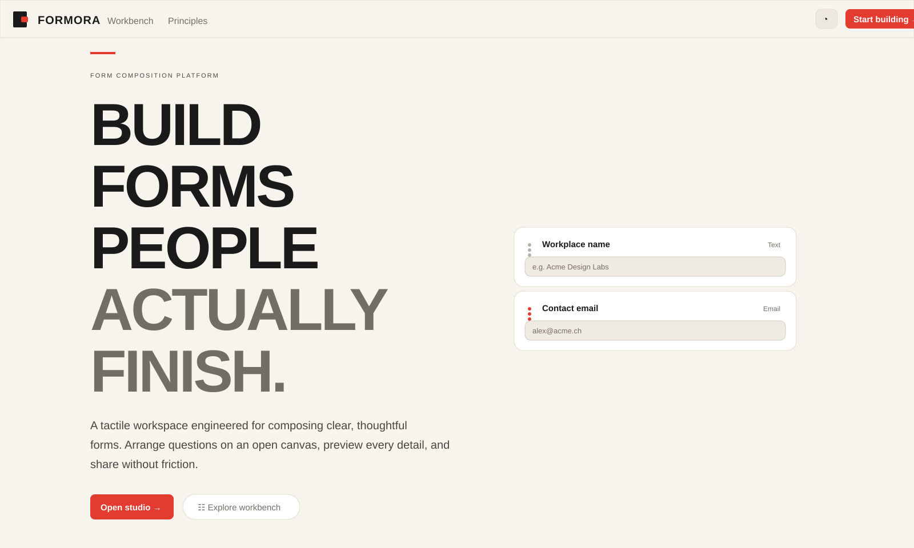

# Formora

<p align="center">
  <strong>Forms that feel effortless.</strong><br />
  A visual form composition workspace for building, previewing, publishing, and collecting responses.
</p>

<p align="center">
  <a href="https://nextjs.org/"></a>
  <a href="https://www.typescriptlang.org/"></a>
  <a href="https://www.prisma.io/"></a>
  <a href="https://clerk.com/"></a>
</p>

<p align="center">
  
</p>

Formora is a product-oriented form composition platform for teams that care about completion, clarity, and control. It turns form creation into a visual workflow: authors arrange a form on an open canvas, configure each field in context, preview the respondent experience, and publish a polished public form from the same workspace.

The application is built as a complete authoring-to-response system rather than a static form mockup. Authentication, ownership checks, persistence, publication, public rendering, response storage, and basic performance signals are connected end to end.

## Product experience

- **Marketing site** — Product positioning, principles, and an interactive workbench preview on `/`.
- **Authenticated console** — Clerk-protected workspace at `/console` with form inventory, published/draft filtering, and aggregate performance statistics.
- **Visual builder** — Protected `/builder/[id]` workspace with drag-and-drop composition, element selection, property editing, draft persistence, and unsaved-change protection.
- **Preview and publishing** — Live preview, route-level preview at `/builder/[id]/preview`, and one-click publication with a stable share URL.
- **Public forms** — Published forms render at `/f/[shareURL]` and accept submissions without requiring respondent authentication.
- **Response accounting** — Public visits increment analytics; valid submissions are stored and increment the form submission counter.

## Why Formora

Traditional form tools often separate structure, presentation, and delivery into disconnected steps. Formora keeps them in one continuous model:

- **Compose visually** instead of editing an abstract configuration first.
- **Keep intent visible** through a focused canvas and contextual field properties.
- **Validate the experience early** with live preview before publication.
- **Publish without handoff** using a stable public URL generated by the application.
- **Measure the outcome** through visit, submission, completion-rate, and bounce-rate signals in the workspace.

## Form composition model

The builder stores a form as a JSON document in `Form.content`. Each element has a stable identifier, a typed element kind, and optional attributes used by its designer, preview, and respondent renderer. The current catalog includes headings, paragraphs, separators, spacing, text, number, date, select, checkbox, and radio elements.

The same document drives the builder canvas, preview, public form, and submission payload, keeping authoring and respondent rendering aligned.

## Application architecture

The application uses the Next.js App Router with server components for authenticated data access and client components for interactive composition.

```text
app/
├── page.tsx                         Marketing homepage
├── (auth)/                          Clerk sign-in and sign-up flows
├── (dashboard)/console/             Authenticated form workspace
├── builder/[id]/                    Form editor and preview routes
└── f/[shareURL]/                    Public published form route

components/
├── FormBuilder.tsx                  Builder state, save/publish, and preview orchestration
├── Designer.tsx                     Drag-and-drop canvas and element selection
├── FormElements.tsx                 Element registry and serializable instances
├── fields/                          Field designers and property panels
└── ui/                              Shared shadcn/Base UI primitives

actions/form.ts                      Authenticated server actions and public submission flow
lib/prisma.ts                        Prisma 7 client using the PostgreSQL driver adapter
prisma/schema.prisma                 Form and FormSubmission persistence model
proxy.ts                             Clerk route protection for console and builder paths
```

### Request and data flow

1. Clerk authenticates the author and protects `/console` and `/builder/*`.
2. Server actions validate ownership before reading or mutating a form.
3. The client-side builder serializes the active element document as JSON when saved or published.
4. Publishing marks the form live and returns its generated `shareURL`.
5. The public route loads only published forms, increments visits, and delegates submission persistence to a server action.
6. The console aggregates stored visit and submission counters into form and workspace metrics.

## Persistence model

| Model | Responsibility |
| --- | --- |
| `Form` | Author ownership, name, description, serialized form content, publication state, share URL, visits, and submission count |
| `FormSubmission` | A timestamped response payload associated with a published form |

Prisma 7 is configured with `@prisma/adapter-pg`; the database URL is loaded through `prisma.config.ts` rather than declared in the Prisma schema datasource block.

## Technology

| Concern | Implementation |
| --- | --- |
| Web application | Next.js 16 App Router and React 19 |
| Language | TypeScript |
| Authentication | Clerk for sign-in, sign-up, and route protection |
| Database | PostgreSQL with Prisma ORM 7 and the `pg` driver adapter |
| Form editing | `@dnd-kit/react`, React state, and a typed element registry |
| Validation | Zod and React Hook Form |
| UI system | Tailwind CSS 4, shadcn/Base UI primitives, CVA, and Lucide icons |
| Motion | GSAP and ScrollTrigger for the marketing experience |
| Typography | Geist and Geist Mono |

## Local development

### Prerequisites

- Node.js 24 or a compatible current Node.js release
- PostgreSQL database
- Clerk application with local development keys

### Setup

```bash
git clone <repository-url>
cd form-drag
npm install
```

Create `.env.local` with the Clerk variables required by the application and a PostgreSQL connection string:

```env
DATABASE_URL="postgresql://..."
NEXT_PUBLIC_CLERK_PUBLISHABLE_KEY="..."
CLERK_SECRET_KEY="..."
```

Apply the database schema, then start the development server:

```bash
npm run db:generate
npm run db:migrate
npm run dev
```

Open [http://localhost:3000](http://localhost:3000). Sign in through Clerk to access the console and builder routes.

## Commands

| Command | Purpose |
| --- | --- |
| `npm run dev` | Start Next.js in development mode |
| `npm run build` | Create a production build |
| `npm run start` | Serve the production build |
| `npm run lint` | Run ESLint |
| `npm run db:generate` | Generate the Prisma client |
| `npm run db:migrate` | Create/apply a local Prisma migration |

## Product maturity

The core authoring and publishing loop is implemented: authenticated form creation, drag-and-drop composition, field configuration, saving, previewing, publishing, public rendering, response persistence, and basic analytics are wired together.

The core product loop is in place. Formora remains under active development, with the next layer focused on richer response management, stronger form lifecycle controls, and expanded analytics beyond the current visit and submission counters.

## Design direction

Formora’s interface follows the same visual system as the product: paper-like surfaces (`#f7f4ed`), charcoal text (`#1a1a1a`), coral signal actions (`#e33b2f`), and quiet neutral borders (`#e2dcd2`). The builder also defines a dark workspace palette with an orange-coral accent for focused editing.

## License

This repository is currently a private application project. Licensing and contribution terms can be added when the project is prepared for external distribution.
